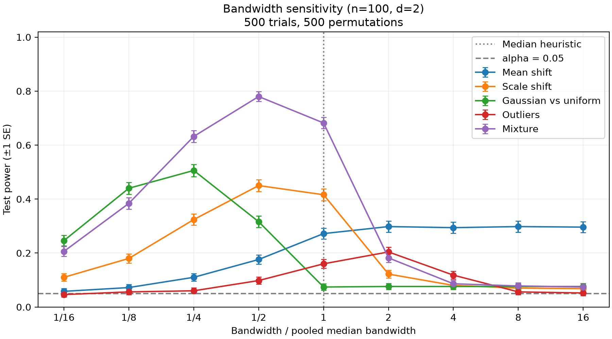
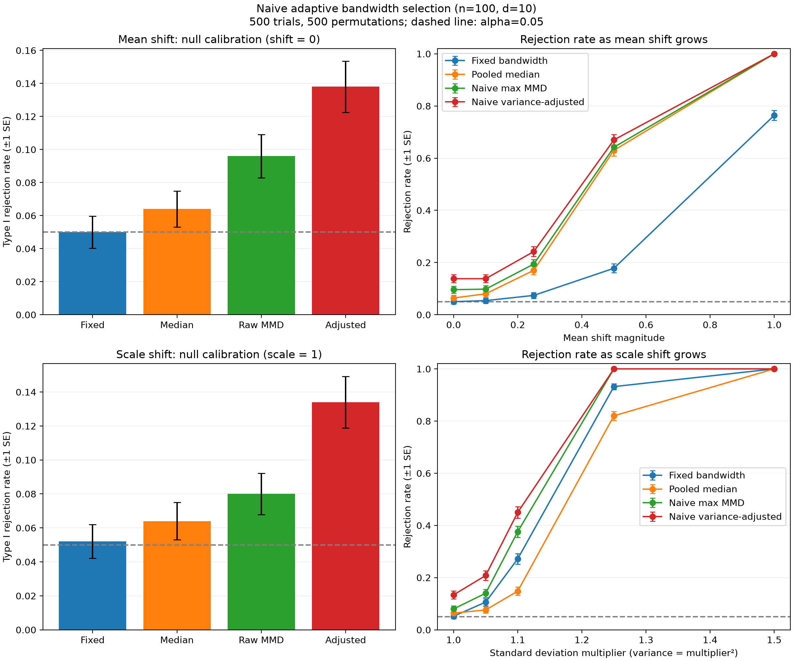
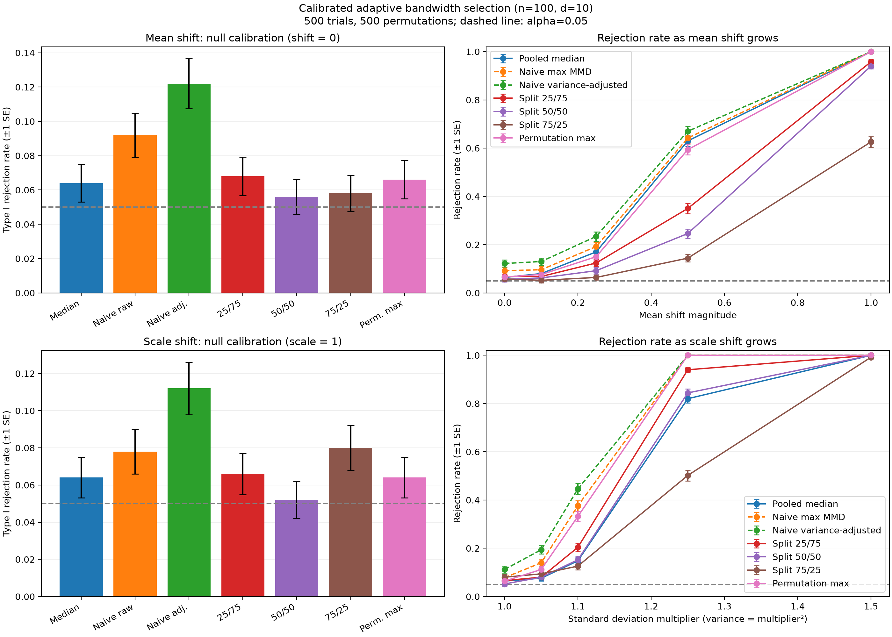
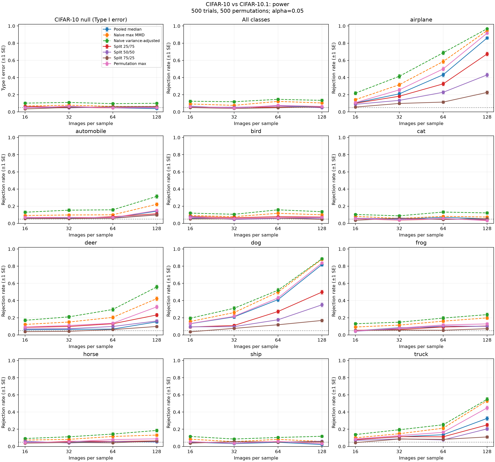
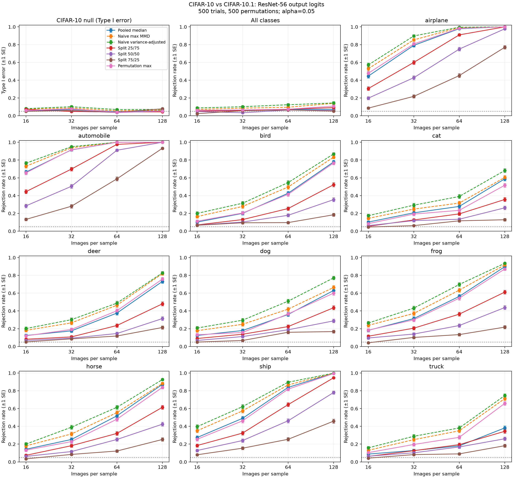

# Kernel selection for MMD tests

The Maximum Mean Discrepancy (MMD) is a useful measure between two probability distributions which allows us to test whether two samples come from the same distribution. The MMD is dependent on a given Reproducing Kernel Hilbert Space (RKHS), and thus depends on the choice of kernel. This project explores the choice of kernel; the aim being to detect real differences as often as possible, while keeping false positives at or below a given level.

For this project, I followed the notes from UCL's [COMP0083: Advanced Topics in Machine Learning](https://www.gatsby.ucl.ac.uk/~gretton/coursefiles/rkhscourse.html) module. I've provided some additional reading materials below.

## The idea behind MMD

Given independent samples from distributions $P$ and $Q$, we want to test $H_0: P = Q$ against $H_1: P \neq Q$.

A positive-definite kernel $k$ defines an RKHS $\mathcal H_k$: a space of functions where evaluating $f$ at $x$ is an inner product, $f(x) = \langle f, k(x, \cdot) \rangle_{\mathcal H_k}$. MMD asks how differently the two distributions behave when measured by functions in this space:

$$
\mathrm{MMD}_k(P,Q) = \sup_{\lVert f \rVert_{\mathcal H_k} \leq 1} \left| \mathbb E_P[f(X)] - \mathbb E_Q[f(Y)] \right| = \lVert \mu_P - \mu_Q \rVert_{\mathcal H_k},
$$

where $\mu_P = \mathbb E_P[k(X, \cdot)]$ is the kernel mean embedding of $P$. The kernel lets us calculate this distance without explicitly working with those functions:

$$
\mathrm{MMD}_k^2(P, Q) = \mathbb E[k(X, X')] + \mathbb E[k(Y, Y')] - 2 \mathbb E[k(X, Y)],
$$

where $X, X' \sim P$ and $Y, Y' \sim Q$ all independent. In practice, we can replace these expectations with averages of kernel values between observations.

Here we use the Gaussian kernel $k_\sigma(x, y) = \exp(-\lVert x - y \rVert^2 / (2 \sigma^2))$. For any $\sigma > 0$, this kernel is characteristic, i.e. the population MMD is zero exactly when $P = Q$. However, when dealing with finite samples, the bandwidth $\sigma$ changes which differences are easy to detect.

A large estimated MMD on its own isn't sufficient to reject $H_0$ since the scale of the MMD depends heavily on the choice of kernel and dimensionality of the data. Under the null hypothesis, the pooled observations are interchangable, so we can compare the observed statistic with values obtained by randomly reassigning group labels. This is called a permutation test which is a non-parametric statistical method meaning it does not assume the data follows a specific probability distribution.

## The Median Heuristic

The pooled median heuristic sets the bandwidth to be the empirical median distance of all pairwise distances within the two samples. This requires no manual tuning or cross-validation, though is not universally suitable.



In this figure, a smaller bandwidth helps distinguish the Gaussian from a uniform sample, while the mean shift benefits from a greater bandwidth.

## Adaptive Bandwidth Selection

Another approach is to perform a search on bandwidths for whichever gives the largest observed MMD, then treat this one as fixed. This can be improved on by maximising $\text{MMD} / \sqrt{\text{Var}}$, which the theory tells us is proportional to the asymptotic test power.



As shown above, these two approaches tend to cause too many false positives as they look for the bandwidth that maximises the MMD statistic. The standard fix is to use a training/test split or cross validation. I implement this in the figure below (where the ratios are selection/test percentages). The permutation-max option keeps all the data and repeats the bandwidth search under every permutation. While these approaches account for selection, splitting leaves fewer observations for the test.



## CIFAR-10 vs CIFAR-10.1

Now we use our MMD statistic on real data. We will consider the CIFAR-10 and CIFAR-10.1 datasets, flattening each image into a vector and scaling it to $[0, 1]$. The CIFAR-10 and CIFAR-10.1 datasets contain 10,000 and 2,000 test images respectively. CIFAR-10.1 was created to evaluate how well image classifiers generalise to truly unseen data, supposedly without distribution shift. We vary the sample size and look at both the dataset as a whole and per class.



We see a noticable distribution shift for several classes (e.g. airplanes and dogs). Importantly, this does not necessarily imply that a model will perform poorly on these CIFAR-10.1 classes if it can well identify the 'core' features of the object.

To investigate this further, I performed MMD tests on the outputs of a pre-trained CIFAR-10 ResNet-56 model with CIFAR-10 inputs vs CIFAR-10.1 inputs. I use [Yaofo Chen's checkpoint](https://github.com/chenyaofo/pytorch-cifar-models), whose author reports 94.37% CIFAR-10 accuracy. 



Interestingly, the model outputs show substantial distribution shifts within most individual classes, while the pooled output distribution changes much less. When all classes are combined, the differences between classes are much larger than the CIFAR-10/CIFAR-10.1 shift within each class, so these smaller shifts can be harder to detect and may partly cancel. This suggests the shift affects the model differently across classes rather than causing one consistent change in its outputs.

## Running the experiments

Use Python 3.12 or newer. From this directory, install the dependencies:

```bash
python -m pip install -r requirements.txt
```

This installs JAX and Matplotlib for the experiments, plus ipykernel for running the notebook. Then you can run any of the experiments, e.g.

```bash
python median_heuristic_experiments.py bandwidth
```

or tests via

```bash
python -m tests.test_kernels
```

You can use `--trials`, `--permutations`, and `--seed` to change the simulation settings, though some scripts have additional arguments. The scripts save PNGs in the working directory.

### CIFAR-10 vs CIFAR-10.1 set-up

Download and extract the Python version of [CIFAR-10](https://www.cs.toronto.edu/~kriz/cifar.html), and download the two v6 NumPy files from the official [CIFAR-10.1 repository](https://github.com/modestyachts/CIFAR-10.1/tree/master/datasets). Arrange them as follows (or use `--data-dir`):

```text
data/
  cifar-10-batches-py/test_batch
  cifar10.1_v6_data.npy
  cifar10.1_v6_labels.npy
```

The ResNet-56 experiment uses PyTorch for inference. It downloads the model's weights to `data/torch_hub` by default and caches inference results to `data/cifar10_resnet56_outputs.npz` after the first run.

## Reading Material

- [Schrab — A Practical Introduction to Kernel Discrepancies: MMD, HSIC & KSD](https://www.gatsby.ucl.ac.uk/~gretton/coursefiles/introAntonin25.pdf): an introduction to kernels, RKHSs, discrepancy estimators, and adaptive kernel selection.
- [Gretton et al. — A Kernel Two-Sample Test](https://www.jmlr.org/papers/volume13/gretton12a/gretton12a.pdf): the foundations of MMD testing.
- [Garreau, Jitkrittum & Kanagawa — Large sample analysis of the median heuristic](https://arxiv.org/abs/1707.07269): a closer look at the bandwidth rule used.
- [Sutherland et al. — Generative Models and Model Criticism via Optimized Maximum Mean Discrepancy](https://arxiv.org/abs/1611.04488): selecting kernels to improve test power.
- [Sutherland — Unbiased estimators for the variance of MMD estimators](https://arxiv.org/abs/1906.02104): more precise variance estimation beyond the simple method used here.
